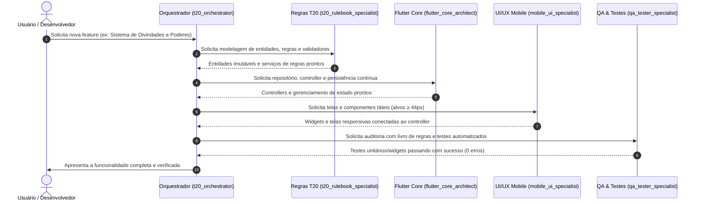

# ⚔️ Squad de Agentes Especializados — T20 Creator

Este diretório contém a especificação oficial, papéis, regras de engajamento e diretrizes operacionais dos **subagentes especializados** e do **orquestrador** do projeto **T20 Creator**.

---

## 👥 Composição do Squad

| Agente | Arquivo de Diretrizes | Identificador | Responsabilidade Principal |
| :--- | :--- | :--- | :--- |
| **Orquestrador / Tech Lead** | [00_t20_orchestrator.md](file:///home/joao/%C3%81rea%20de%20trabalho/Projetos%20/Tormenta-criador_personagem/t20_creator/Agents/00_t20_orchestrator.md) | `t20_orchestrator` | Planeja, divide tarefas, mantém ADRs e consolida entregas |
| **Especialista em Regras T20** | [01_t20_rulebook_specialist.md](file:///home/joao/%C3%81rea%20de%20trabalho/Projetos%20/Tormenta-criador_personagem/t20_creator/Agents/01_t20_rulebook_specialist.md) | `t20_rulebook_specialist` | Regras canônicas T20 JdA, fórmulas, bônus, pré-requisitos e domínio |
| **Arquiteto Flutter & Estado** | [02_flutter_core_architect.md](file:///home/joao/%C3%81rea%20de%20trabalho/Projetos%20/Tormenta-criador_personagem/t20_creator/Agents/02_flutter_core_architect.md) | `flutter_core_architect` | Clean Architecture, imutabilidade, controllers e persistência contínua |
| **Designer de UI/UX Mobile RPG** | [03_mobile_ui_specialist.md](file:///home/joao/%C3%81rea%20de%20trabalho/Projetos%20/Tormenta-criador_personagem/t20_creator/Agents/03_mobile_ui_specialist.md) | `mobile_ui_specialist` | Telas e widgets táteis ($\ge 44\text{px}$), fichas de sessão e tema escuro |
| **Engenheiro VTT & Rede LAN** | [04_vtt_realtime_specialist.md](file:///home/joao/%C3%81rea%20de%20trabalho/Projetos%20/Tormenta-criador_personagem/t20_creator/Agents/04_vtt_realtime_specialist.md) | `vtt_realtime_specialist` | Grid 2D de combate, sincronização WebSocket LAN e modo offline (ADR-002) |
| **Auditor de Qualidade & Testes** | [05_qa_tester_specialist.md](file:///home/joao/%C3%81rea%20de%20trabalho/Projetos%20/Tormenta-criador_personagem/t20_creator/Agents/05_qa_tester_specialist.md) | `qa_tester_specialist` | Testes unitários com livros de regras, testes de widget e regressão |

---

## 🔄 Fluxo de Trabalho Integrado

---

## 📌 Documentos Arquiteturais Relacionados
- [ADR-001: Painel do Personagem e Integração de Arquitetura](file:///home/joao/%C3%81rea%20de%20trabalho/Projetos%20/Tormenta-criador_personagem/t20_creator/documentation/ADR/ADR-001-painel-do-personagem-e-integracao-de-arquitetura.md)
- [ADR-002: Módulo de Combate VTT 2D, Sandbox Offline e Painel do Mestre via LAN WebSocket](file:///home/joao/%C3%81rea%20de%20trabalho/Projetos%20/Tormenta-criador_personagem/t20_creator/documentation/ADR/ADR-002-combate-vtt-e-painel-do-mestre-lan.md)
- [Diretrizes de Karpathy (Anti-Overengineering)](file:///home/joao/%C3%81rea%20de%20trabalho/Projetos%20/Tormenta-criador_personagem/t20_creator/.agents/skills/karpathy-guidelines/SKILL.md)
